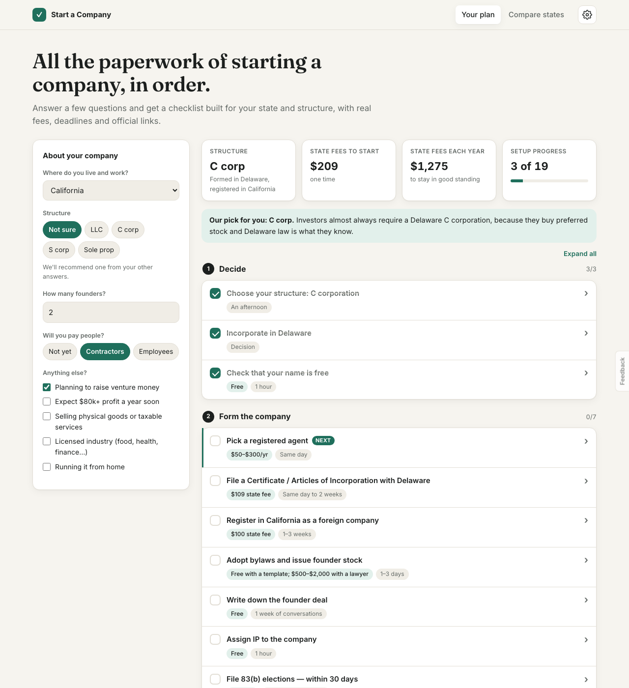
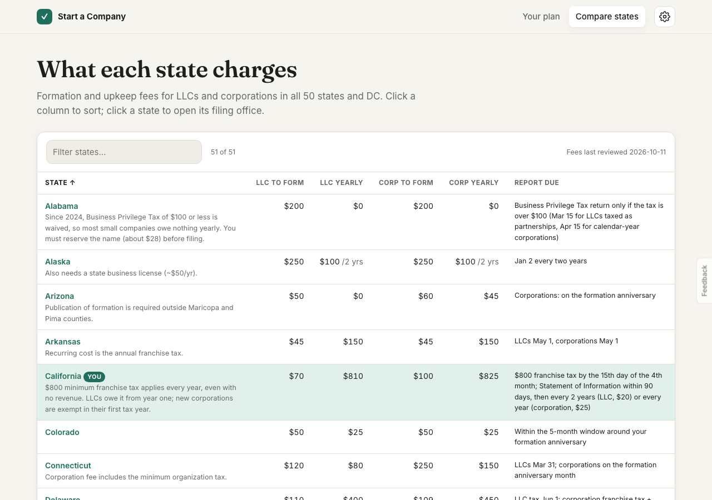
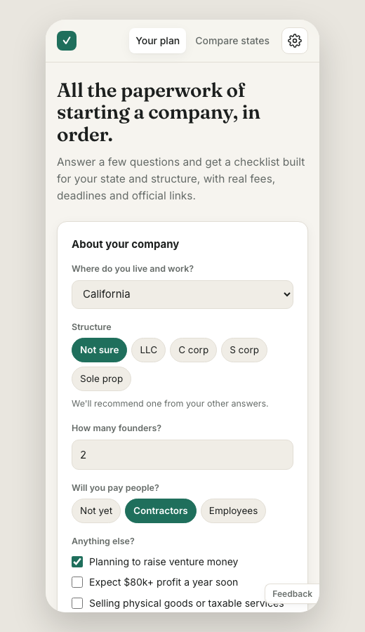
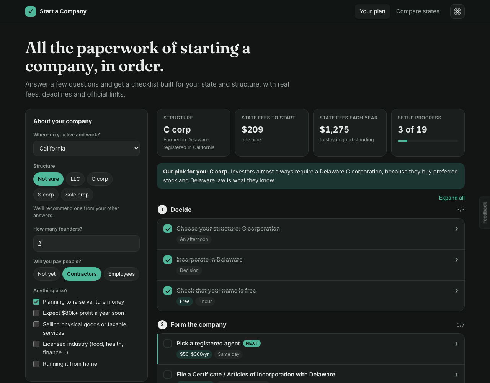
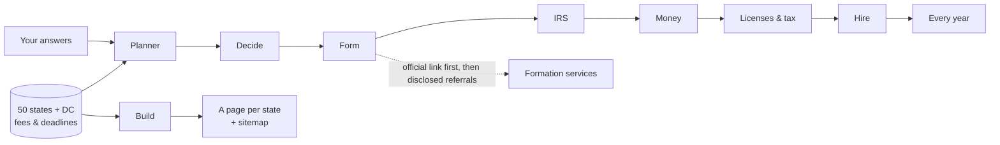

# Start a Company

A personal, step-by-step checklist for the paperwork of starting a US company. You answer a few questions and get your structure, state filings, IRS, bank, licenses and yearly upkeep, with fees checked for all 50 states and DC.

**[Open the site →](https://amalmehta.github.io/StartACompany/)** · **[Fees by state →](https://amalmehta.github.io/StartACompany/states/)**

| Compare every state's fees | On a phone | Dark mode |
|---|---|---|
|  |  |  |

Free for founders. The site may earn a referral fee when someone chooses a paid formation service; the do-it-yourself official link always comes first.

## Links

- [Instructions](docs/INSTRUCTIONS.md): run it, use it, update the fee data
- [System design](docs/SYSTEM-DESIGN.md): architecture, flows, decisions, limits
- [File structure](docs/FILE-STRUCTURE.md): what's where
- [Go live](docs/GO-LIVE.md): owner-only steps to start earning (partner IDs, lawyer review, domain, weekly check)
- [Improvements log](docs/IMPROVEMENTS.md): the 2026-10-11 review
- [Terms](https://amalmehta.github.io/StartACompany/terms.html) · [Privacy](https://amalmehta.github.io/StartACompany/privacy.html)

*Not legal or tax advice. Fees change, so confirm on the official site linked from each step.*
