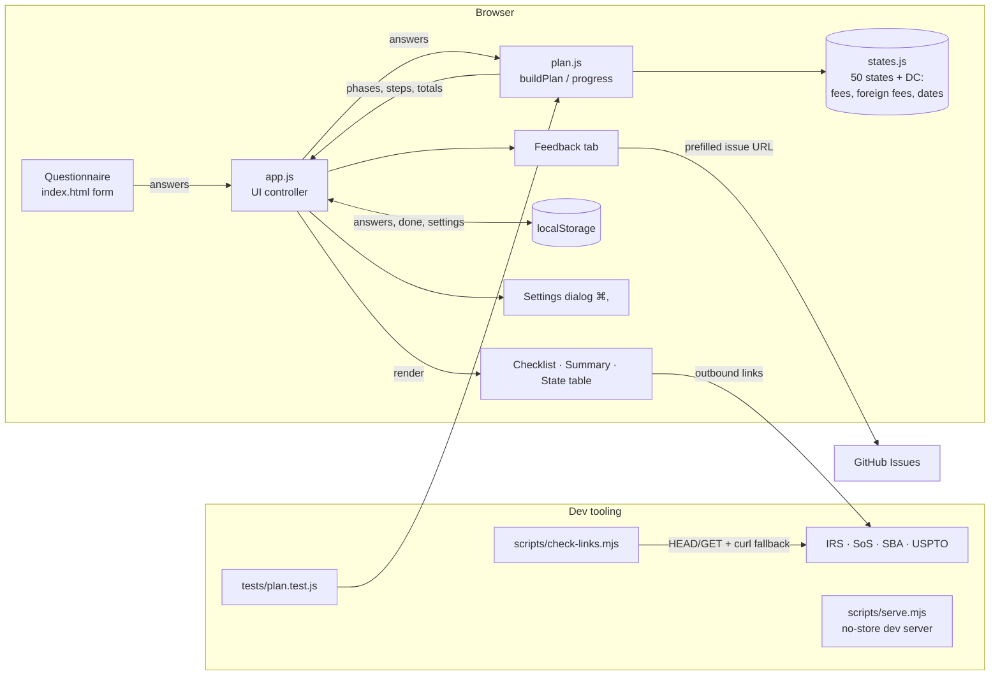

# System Design

Start a Company is a static website. It asks a founder seven questions and returns an ordered checklist of every legal, tax and compliance step for their US state and business structure. There is no server and no account. Everything runs and is saved in the browser.

## Architecture

## Components

| File | Job |
|---|---|
| `index.html` | Page shell: header and nav, questionnaire, plan area, state table, settings and feedback dialogs. A tiny inline script applies a forced theme before first paint. An **import map** gives every module one `?v=` version so caches can't mix releases. |
| `styles.css` | All styling. Color tokens on `:root` with light and dark themes (system preference or forced by a setting), a responsive two-column layout that becomes one column under 880px, and print styles. |
| `src/plan.js` | **The brains.** Pure functions with no DOM. `resolve()` turns answers into facts (entity, which state to form in, whether a foreign registration is needed). `buildPlan()` filters and renders the step catalogue (`STEPS`), totals the state fees (using foreign-registration fees where they apply), and attaches `warnings()` for conflicting answers and any newspaper-publication cost. `recommendEntity()` handles "Not sure". `progress()` counts finished setup steps. |
| `src/data/states.js` | Formation fees, yearly cost (report fee + any minimum tax), foreign-registration fees, cadence, due dates, notes and the official filing-office URL for each of the 50 states plus DC. `DATA_REVIEWED` is shown in the UI. |
| `src/store.js` | Guarded `localStorage` read, write and clear. The app still works if storage is blocked. |
| `src/app.js` | Wires everything together: form → plan → render, checkbox and expand state, sortable and filterable state table, hash routing between tabs, settings (theme, cost display, hide finished, expand all, export, import, print, reset), and the feedback dialog. |
| `tests/plan.test.js` | Node's built-in test runner against `plan.js`, `states.js` and the import map in `index.html`. |
| `scripts/check-links.mjs` | Visits every URL the site can show. Falls back to curl when Node can't verify a certificate chain that browsers accept, and lists bot-blocked sites separately. |
| `scripts/serve.mjs` | Local static server with `Cache-Control: no-store`. |
| `.github/workflows/test.yml` | CI: `npm test` on every push and PR. |

## Main flows

1. **Build a plan.** Any form `input` event → `state.answers` is updated → saved → `buildPlan(answers)` → the summary cards and phases are re-rendered. With no state chosen, `buildPlan` returns `null` and the empty state shows.
2. **Conflicting answers.** `warnings()` returns plain-language notes when answers conflict, for example an S corp that plans to raise VC, or a "sole prop" with several founders. They're shown above the checklist. The plan is still built as asked.
3. **Not sure which structure.** With `entity: "unsure"`, `recommendEntity` picks one: a Delaware C corp if raising VC, an S corp if profit is expected soon, otherwise a home-state LLC. The plan is built for that pick and the reason is shown.
4. **Delaware plus home state.** A C corp formed in Delaware while living elsewhere sets `foreign = true`. That adds a foreign-registration step, priced with the home state's **foreign** fee (Texas charges $750, not its $300 domestic fee), a second yearly report, and both states' fees to the totals.
5. **Check off steps.** Checkbox → `state.done[id]` → saved → re-render. Focus goes back to the same checkbox, and a polite live region announces progress. Progress counts only one-time setup steps; the first unfinished one gets a **Next** badge.
6. **Settings.** Gear button or ⌘, / Ctrl+, opens the dialog. Changes apply immediately and are saved.
7. **Feedback.** The side tab opens a dialog. Submitting opens a prefilled GitHub issue in a new tab, optionally with the person's state and structure, which they review and post themselves.

## Where data lives

- **Reference data**: `src/data/states.js` and the `STEPS` catalogue in `src/plan.js`. These are versioned in git.
- **User data**: one `localStorage` key, `start-a-company:v1` → `{ answers, done, settings }`. It is never sent anywhere. Export and import move it between browsers as JSON.

## Key decisions and trade-offs

| Decision | Why | Trade-off |
|---|---|---|
| Static site, no backend | Free to host on GitHub Pages, private by design, nothing to maintain | No sync across devices (export/import covers it); feedback goes through GitHub |
| No framework or build step | ES modules in the browser; the same `plan.js` runs in Node tests | Manual DOM rendering; fine at this size |
| Steps as data with `when(c)` predicates | Adding or changing a rule is one object; easy to test exhaustively | Copy lives in JS rather than a CMS |
| Fees hard-coded with a review date and an official link on every step | Gives real numbers people can budget with | Fees go stale; the date and links make that visible |
| Yearly cost = report fee + minimum tax owed regardless of revenue | One consistent rule, so states compare fairly (CA's $800, RI's $400, TN's $100 and DE's APV minimum are all counted) | Taxes that scale with revenue or capital aren't counted; notes mention them |
| Versioned import map instead of a bundler | Keeps "no build step" while preventing stale-module mixes after a deploy | The version has to be bumped by hand; a test checks every module uses the same one |
| State fee totals only | These are the numbers people get wrong and they're knowable | Lawyer, agent, insurance and CPA costs appear as ranges per step, not in the totals |
| Delaware offered only for C corps | That's where Delaware actually pays off | LLC-in-Wyoming/Delaware strategies aren't modelled |

## Testing

- `npm test` runs 24 Node tests. They check the state data shape (51 entries, valid numbers and URLs) and each branching rule (VC → DE C corp + foreign registration, solo and multi-member LLC returns, sole prop, S corp, publication states, biennial and no-report states, optional situations, progress). One test builds a plan for **every state × every structure** and checks that no text contains `undefined`, `null` or `NaN`. Others cover warnings, foreign fees, publication costs, recurring filings, Delaware naming and the import map.
- `npm run check-links` checks every official URL (68 at last run). The 2026-10-11 data review also checked each state's fees against official schedules; see `docs/IMPROVEMENTS.md`.
- The UI was checked by hand in a browser at desktop (1280px) and phone (375px) widths, in light and dark themes: focus handling, live announcements, settings, feedback validation, the state table and print.

## Known limits

- US only. Fees are compiled from public sources and reviewed on the date shown. They are not live, and some states add surcharges or expedite fees.
- City and county licences, state sales-tax agencies and industry licences link to general SBA guidance rather than each local office.
- Assumes a calendar tax year for federal deadlines.
- Some fees scale with authorized shares, capital or member count (TN LLCs, NM/OK/VA corporations, the DE franchise tax). The data holds the minimum or typical-startup figure.
- A few state sites block scripts (AK, GA, MA, NY, OH), so `check-links` reports them as "blocked". They were confirmed in a browser on 2026-10-11.
- Not legal or tax advice. It doesn't file anything for you.
- ⌘, may be captured by some browsers before the page sees it. The gear button always works.
