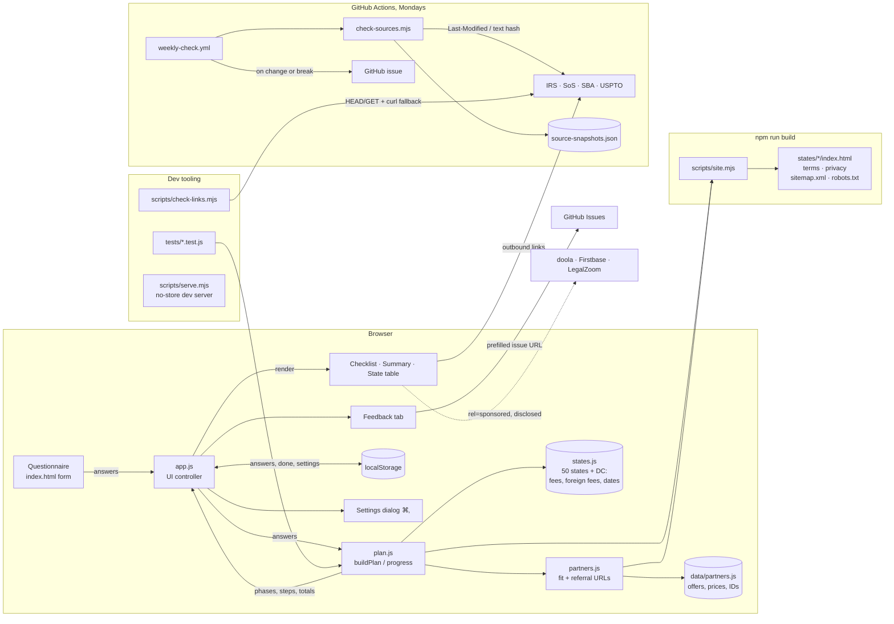

# System Design

Start a Company is a static website. It asks a founder a few questions and returns an ordered checklist of every legal, tax and compliance step for their US state and business structure. There is no server and no account. Everything runs and is saved in the browser. A build script also writes a static page per state from the same data, for search engines and link previews.

It is free for founders. It earns money through referral fees from formation services (doola, Firstbase, LegalZoom), shown only where they fit, always after the official do-it-yourself link, and only once the owner has pasted referral IDs.

## Architecture

## Components

| File | Job |
|---|---|
| `index.html` | Page shell: header and nav, questionnaire, plan area, state table, settings and feedback dialogs. A tiny inline script applies a forced theme before first paint. An **import map** gives every module one `?v=` version so caches can't mix releases. |
| `styles.css` | All styling. Color tokens on `:root` with light and dark themes (system preference or forced by a setting), a responsive two-column layout that becomes one column under 880px, and print styles. |
| `src/plan.js` | **The brains.** Pure functions with no DOM. `resolve()` turns answers into facts (entity, which state to form in, whether a foreign registration is needed). `buildPlan()` filters and renders the step catalogue (`STEPS`), totals the state fees (using foreign-registration fees where they apply), and attaches `warnings()` for conflicting answers and any newspaper-publication cost. `recommendEntity()` handles "Not sure". `progress()` counts finished setup steps. |
| `src/data/partners.js` | Partner config: name, offer, public price and its source URL, referral URL template, referral ID (empty until the owner pastes one), `enabled`, whether it has a referral program, and which situations it fits. |
| `src/partners.js` | Pure functions: `referralUrl()` (null unless enabled, https and an ID is filled), `situations()` (non-US founders, Delaware C corp, LLC), `servicesFor()` (live paid partners that fit, plus "no referral" services for comparison, or nothing at all), `servicesHTML()` (disclosure first, `rel="sponsored noopener"` on paid links). Used by the app, the build and the tests. |
| `src/data/states.js` | Formation fees, yearly cost (report fee + any minimum tax), foreign-registration fees, cadence, due dates, notes and the official filing-office URL for each of the 50 states plus DC. `DATA_REVIEWED` is shown in the UI. |
| `src/store.js` | Guarded `localStorage` read, write and clear. The app still works if storage is blocked. |
| `src/app.js` | Wires everything together: form → plan → render, checkbox and expand state, sortable and filterable state table, hash routing between tabs, settings (theme, cost display, hide finished, expand all, export, import, print, reset), and the feedback dialog. |
| `scripts/site.mjs` | Pure page builders: a page per state (fees table, LLC and corporation filings taken from `buildPlan`, sources, fitting partners, a link that starts a plan for that state), the state index, terms and privacy (text from `content/`), sitemap, robots.txt, and the canonical/Open Graph URLs in `index.html`. `siteBase()` picks the absolute base: `SITE_URL`, else `CNAME`, else GitHub Pages. |
| `scripts/build-pages.mjs` | `npm run build` writes the generated files; `--check` exits 1 if any committed one is stale. |
| `scripts/check-sources.mjs` | Fingerprints every fee source (Last-Modified if it's a real date, else a hash of the visible text) and every partner price page (are the configured dollar amounts still there), compares with `scripts/source-snapshots.json`, and writes a Markdown report for the issue. `--update` records a new baseline. |
| `content/terms.html`, `content/privacy.html` | Text of the legal pages, marked as templates for legal review. |
| `tests/*.test.js` | Node's built-in test runner: `plan.test.js` (planning logic, data, import map), `partners.test.js`, `site.test.js`, `sources.test.js`. |
| `scripts/check-links.mjs` | Visits every URL the site can show. Falls back to curl when Node can't verify a certificate chain that browsers accept, and lists bot-blocked sites separately. |
| `scripts/serve.mjs` | Local static server with `Cache-Control: no-store`. |
| `.github/workflows/test.yml` | CI: `npm test` on every push and PR. |
| `.github/workflows/weekly-check.yml` | Mondays: tests, generated-pages check, `check-links`, `check-sources`. On any failure it opens an issue labelled `weekly-check`, or comments on the open one. |

## Main flows

1. **Build a plan.** Any form `input` event → `state.answers` is updated → saved → `buildPlan(answers)` → the summary cards and phases are re-rendered. With no state chosen, `buildPlan` returns `null` and the empty state shows.
2. **Conflicting answers.** `warnings()` returns plain-language notes when answers conflict, for example an S corp that plans to raise VC, or a "sole prop" with several founders. They're shown above the checklist. The plan is still built as asked.
3. **Not sure which structure.** With `entity: "unsure"`, `recommendEntity` picks one: a Delaware C corp if raising VC, an S corp if profit is expected soon, otherwise a home-state LLC. The plan is built for that pick and the reason is shown.
4. **Delaware plus home state.** A C corp formed in Delaware while living elsewhere sets `foreign = true`. That adds a foreign-registration step, priced with the home state's **foreign** fee (Texas charges $750, not its $300 domestic fee), a second yearly report, and both states' fees to the totals.
5. **Check off steps.** Checkbox → `state.done[id]` → saved → re-render. Focus goes back to the same checkbox, and a polite live region announces progress. Progress counts only one-time setup steps; the first unfinished one gets a **Next** badge.
6. **Settings.** Gear button or ⌘, / Ctrl+, opens the dialog. Changes apply immediately and are saved.
7. **Referral links.** `buildPlan` attaches `services` to the filing step only: `servicesFor(situations(c))`. The app renders them inside that step after the official filing link, under a "Paid links" disclosure. With no live partner that fits, the list is empty and nothing renders, not even the disclosure.
8. **State pages.** `npm run build` calls `buildPlan` for an LLC and a home-state corporation in each state and lists the filing, publication and yearly-report steps with their costs. The "Build my checklist" button links to `../../?state=XX#plan`; `app.js` reads `state`, saves it, and removes it from the address.
9. **Weekly check.** The workflow runs everything that can go stale. A change opens an issue with a checklist; the owner fixes data, rebuilds, runs `check-sources -- --update` and commits.
10. **Feedback.** The side tab opens a dialog. Submitting opens a prefilled GitHub issue in a new tab, optionally with the person's state and structure, which they review and post themselves.

## Where data lives

- **Reference data**: `src/data/states.js` and the `STEPS` catalogue in `src/plan.js`. These are versioned in git.
- **Partner config**: `src/data/partners.js`, versioned in git. Referral IDs are public by nature (they appear in links), so they live in the repo.
- **Source fingerprints**: `scripts/source-snapshots.json`, versioned in git, updated by `check-sources -- --update`.
- **Generated pages**: `states/`, `terms.html`, `privacy.html`, `sitemap.xml`, `robots.txt`, committed because GitHub Pages serves the repo as-is.
- **User data**: one `localStorage` key, `start-a-company:v1` → `{ answers, done, settings }`. It is never sent anywhere, including to partners. Export and import move it between browsers as JSON. `privacy.html` lists every field.

## Key decisions and trade-offs

| Decision | Why | Trade-off |
|---|---|---|
| Static site, no backend | Free to host on GitHub Pages, private by design, nothing to maintain | No sync across devices (export/import covers it); feedback goes through GitHub |
| No framework or build step | ES modules in the browser; the same `plan.js` runs in Node tests | Manual DOM rendering; fine at this size |
| Steps as data with `when(c)` predicates | Adding or changing a rule is one object; easy to test exhaustively | Copy lives in JS rather than a CMS |
| Fees hard-coded with a review date and an official link on every step | Gives real numbers people can budget with | Fees go stale; the date and links make that visible |
| Yearly cost = report fee + minimum tax owed regardless of revenue | One consistent rule, so states compare fairly (CA's $800, RI's $400, TN's $100 and DE's APV minimum are all counted) | Taxes that scale with revenue or capital aren't counted; notes mention them |
| Versioned import map instead of a bundler | Keeps "no build step" while preventing stale-module mixes after a deploy | The version has to be bumped by hand; a test checks every module uses the same one |
| State fee totals only | These are the numbers people get wrong and they're knowable | Lawyer, agent, insurance and CPA costs appear as ranges per step, not in the totals |
| Delaware offered only for C corps | That's where Delaware actually pays off | LLC-in-Wyoming/Delaware strategies aren't modelled |
| Referral income, not charging founders | Keeps the tool free and private; formation services already pay for referrals | Income depends on partner programs; the site must stay visibly honest to deserve the clicks |
| Partners only where they fit, official link first, disclosure above, off with no IDs | Honest by construction: a partner can't appear on a plan it doesn't suit, and deploying before joining programs shows nothing | Fewer placements than a banner would give |
| Stripe Atlas listed as "no referral" next to paid options | Delaware C corp founders should see the best-known option even though it pays nothing | Can send people to a service that earns the site nothing |
| One "Some founders live outside the US" question | Needed to know when doola and Firstbase genuinely fit; it also changes real advice (no online EIN without an SSN/ITIN; no S corp with nonresident owners) | One more question on the form |
| Generated static pages, committed | Search engines and link previews get real HTML per state with no server and no framework | Files must be rebuilt after data changes; a test catches a forgotten build |
| Relative links everywhere; absolute URLs from `SITE_URL`/`CNAME` | The same files work at `/StartACompany/` and at a custom domain root | Canonical URLs need a rebuild when the domain changes |
| Source check by Last-Modified or text hash; partner pages by price amounts | Official pages rarely change, so any change is worth a look; marketing pages change constantly, so only the price matters | Text hashes give false alarms on redesigns; pages behind bot walls can't be checked automatically |

## Testing

- `npm test` runs 49 Node tests. The original 24 cover planning, plus one for founders outside the US. `partners.test.js` (7) checks the config shape, that the shipped config has no IDs and shows nothing, URL filling, fit rules per answer set, `rel="sponsored noopener"`, and that the disclosure comes before the links. `site.test.js` (10) checks the committed pages match a fresh build, one page per state with a unique title, description, canonical, fees and official link, that every link is relative and resolves, the base-URL rules, the sitemap, partners on state pages once IDs exist, and that the privacy page names the real storage key and fields. `sources.test.js` (7) covers text normalization, Last-Modified trust, bot walls, dollar amounts, change classification, the issue report and that every source has a baseline. The original planning tests check the state data shape (51 entries, valid numbers and URLs) and each branching rule (VC → DE C corp + foreign registration, solo and multi-member LLC returns, sole prop, S corp, publication states, biennial and no-report states, optional situations, progress). One test builds a plan for **every state × every structure** and checks that no text contains `undefined`, `null` or `NaN`. Others cover warnings, foreign fees, publication costs, recurring filings, Delaware naming and the import map.
- `npm run check-links` checks every official URL, partner price page and live referral link (72 at last run, 0 broken, 6 blocking scripts).
- `npm run check-sources` was run twice in a row after recording the baseline on 2026-10-22 with no false changes: 45 unchanged, 10 behind bot walls (AK, CA, GA, IA, MA, MT, NV, ND, NY, OH). The 2026-10-11 data review also checked each state's fees against official schedules; see `docs/IMPROVEMENTS.md`.
- The UI was checked by hand in a browser at desktop (1280px) and phone (375px) widths, in light and dark themes: focus handling, live announcements, settings, feedback validation, the state table and print.

## Known limits

- US only. Fees are compiled from public sources and reviewed on the date shown. They are not live, and some states add surcharges or expedite fees.
- City and county licences, state sales-tax agencies and industry licences link to general SBA guidance rather than each local office.
- Assumes a calendar tax year for federal deadlines.
- Some fees scale with authorized shares, capital or member count (TN LLCs, NM/OK/VA corporations, the DE franchise tax). The data holds the minimum or typical-startup figure.
- A few state sites block scripts (AK, GA, MA, NY, OH), so `check-links` reports them as "blocked". They were confirmed in a browser on 2026-10-11.
- Not legal or tax advice. It doesn't file anything for you. Whether a personalised checklist counts as legal advice in some states is a question for a lawyer (see `docs/GO-LIVE.md`).
- The referral URL templates in `src/data/partners.js` are placeholders; the real link format comes from each partner dashboard.
- Partner prices are checked by hand and watched weekly, but promotions change often.
- `check-sources` can't see pages that serve scripts a bot wall; those are listed for a manual check.
- The legal pages are templates, not reviewed by a lawyer.
- ⌘, may be captured by some browsers before the page sees it. The gear button always works.
